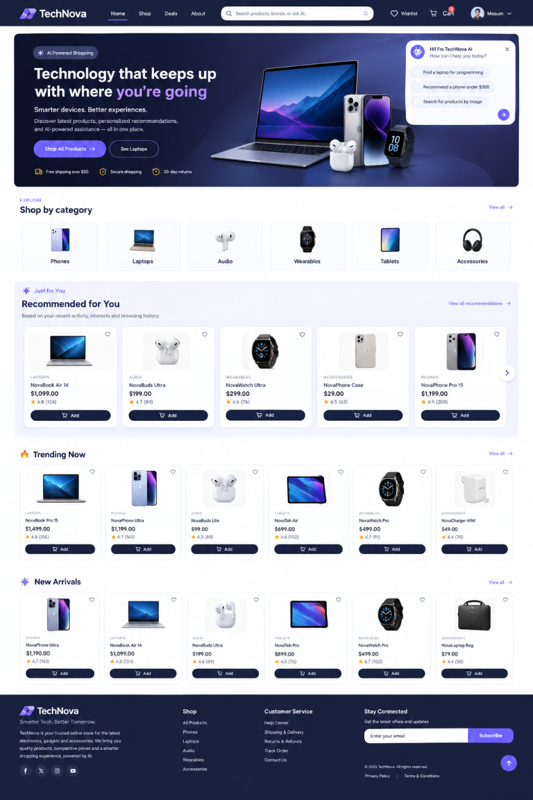

# TechNova — Full-Stack Electronics Store

TechNova is a full-stack electronics e-commerce application built with React,
Spring Boot, and MySQL. It includes a product catalog, accounts, cart,
checkout, orders, administration tools, and optional AI and map integrations.

**Repository:** [github.com/masumDevLab/technova](https://github.com/masumDevLab/technova)

## Storefront preview



## Features

- Browse, search, filter, and compare products
- Register and sign in, manage a profile, wishlist, cart, and orders
- Complete checkout and review order history
- Admin tools for products, categories, users, orders, sales, and store settings
- Contact form and store-location map
- Optional AI shopping assistant

## Technology

- Frontend: React 19, Vite, Tailwind CSS
- Backend: Java 21, Spring Boot 3.5, MyBatis
- Database: MySQL 8
- Optional integrations: DeepSeek AI and AMap

## Project structure

```text
technova-Front/      React storefront and admin UI
technova-backend/    Spring Boot REST API, MyBatis, and MySQL setup
```

## Requirements

- Node.js 20.19+ or 22.12+ and npm
- JDK 21
- Maven 3.8+ for local backend runs, or Docker Compose
- MySQL 8 for local backend runs without Docker

## Run with Docker

1. Copy `technova-backend/.env.example` to
   `technova-backend/.env`.
2. Set a local database password and a long, random `JWT_SECRET` in that file.
   Add `DEEPSEEK_API_KEY` only if you want to use the AI features.
3. From `technova-backend`, start the database and API:

   ```powershell
   docker compose up --build
   ```

4. In another terminal, optionally configure AMap by copying
   `technova-Front/.env.example` to `technova-Front/.env` and adding your own
   credentials.
5. Start the frontend:

   ```powershell
   cd technova-Front
   npm install
   npm run dev
   ```

Open the local URL printed by Vite. The frontend proxies `/api` requests to the
backend at `http://localhost:8080`.

## Run without Docker

1. Start MySQL 8 and create a database named `shop`.
2. Initialize it using `technova-backend/init.sql`. **This script drops and
   recreates the application's tables. Do not run it against data you need to
   keep.**
3. In a PowerShell terminal, set the backend environment:

   ```powershell
   $env:DB_HOST = "localhost"
   $env:DB_PORT = "3306"
   $env:DB_USERNAME = "root"
   $env:DB_PASSWORD = "your_mysql_password"
   $env:JWT_SECRET = "your_long_random_secret"
   ```

4. Start the backend from `technova-backend`:

   ```powershell
   mvn spring-boot:run
   ```

5. Start the frontend as described above.

`DEEPSEEK_API_KEY` and AMap credentials are optional and are only needed for
their respective integrations. Never commit `.env` files, passwords, API keys,
or production secrets.

## Useful commands

From `technova-Front`:

```powershell
npm run lint
npm run build
```

From `technova-backend`:

```powershell
mvn test
```

Do not commit `.env` files, credentials, or production secrets. The
`.env.example` files document the configuration variables required for local
development.
